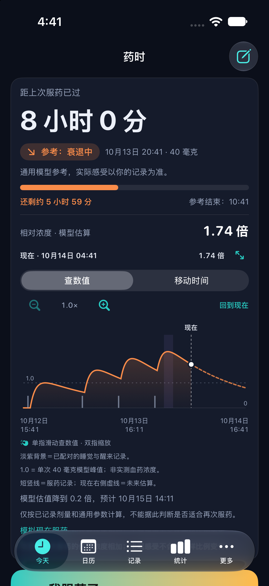

# 药时 · YaoShi

记录服药时间、感受、进食和睡眠，让这一轮发生的事情更容易回看。欢迎通过 Issue 提建议，或提交 Pull Request 一起改进。项目采用 [MIT 许可证](LICENSE)。

## 功能

- 曲线按住、左右滑动选择时间点，同时查看时间和模型数值；支持双指缩放与时间平移，时间轴可继续向过去和未来延展。
- 试算页可拖动模拟服药时刻，比较不加新剂与模拟后的两条曲线；试算不写入实际记录。
- 以本轮第一条服药记录为起点，跨天查看实际记录的进食、入睡和醒来；可补填、修改时间。
- iPhone / iPad 共用代码；iPad 提供宽屏布局。Mac 版使用 Mac Catalyst 构建。
- 大屏展示页可通过系统屏幕镜像投放到 Apple TV；本机可查值、移动与缩放。
- 原生 tvOS 看板提供遥控器查值、平移、缩放及常显模式；与手机显式配对，接收最小化的曲线快照。
- 小组件、实时活动、Apple Watch 与独立的只读伴侣 App 源码一并保留。
- “我的 → 关于”显示版本号与源码提交，便于核对设备；统一版本配置在 `version.json`。

曲线是通用模型估算，不是实测血药浓度，不用于决定剂量或再次服药。没有进食或睡眠记录不代表没有发生。记录分轮也不代表药效持续时间。

<details>
<summary>iPhone 曲线预览（合成测试数据）</summary>



</details>

## 开发与构建

需要 macOS、Xcode、Command Line Tools、Python 3 与对应 SDK。当前通过 shell 脚本直接调用 Apple 工具链，没有 Xcode 工程或第三方包依赖。共享代码位于 `Shared/PartnerSync`。

```sh
bash tests/run_sync_tests.sh
python3 -m unittest discover -s tests -p 'test_*.py'
YAOSHI_SIM_DIR=/tmp/yaoshi-review bash build_sim.sh
```

模拟器构建不需要开发者签名。构建脚本仅生成 App；可用 `xcrun simctl install booted /tmp/yaoshi-review/药时.app` 安装到已启动的 iPhone 或 iPad 模拟器。

真机构建需要 Apple Development 签名身份和允许对应 Bundle ID、Keychain 组的 provisioning profile。签名证书和描述文件须在本机配置，不存入仓库：

```sh
export YAOSHI_SIGNING_IDENTITY='本机的 Apple Development 签名身份或证书 SHA-1'
export YAOSHI_BUILD_DIR="$(mktemp -d /tmp/yaoshi-device.XXXXXX)"
bash build.sh
bash build_widget.sh
# 可选：bash build_watch.sh
```

本项目保留原有 Bundle ID 与 Apple Team ID，保证现有安装的升级和钥匙串访问连续性；这些是公开标识，不是密钥。其他开发者要在自己的 Apple Developer 团队下运行真机版，需同时配置构建脚本、源码中的 Bundle ID / Keychain 组与描述文件。不要直接替换已有用户安装使用的标识。

Mac 本机版（macOS 14+，Apple Silicon 默认构建）：

```sh
YAOSHI_MAC_BUILD_DIR="$(mktemp -d /tmp/yaoshi-mac.XXXXXX)" bash build_mac.sh
```

默认使用本机临时签名和独立沙盒，仅记录本机数据。iPhone ↔ Mac 共享钥匙串需要匹配的 Mac provisioning profile 与签名身份；当前不宣称跨平台同步已验证。可通过 `YAOSHI_MAC_PROFILE`、`YAOSHI_MAC_SIGNING_IDENTITY` 指定自己的有效配置。

平台验收状态随版本发布说明维护。编译通过不等于已经验证真机触摸、同步、推送或跨设备行为。伴侣 App 的服务端不在此仓库内，不能只靠编译客户端启用远程共享。

### 2.10.8（37）限时后台定位实验

仅当构建显式设置 `YAOSHI_BACKGROUND_LOCATION_EXPERIMENT=1` 时，iOS 包加入后台定位声明和“我的”页面实验入口。默认关闭，由使用者点击启动并通过系统定位授权后进行十五分钟测试，可随时停止，不自动重启、不跨设备同步、不保存或上传位置。实验以后台运行机会触发每三十秒一次的浓度发布尝试，记录无坐标的前后台发布时间用于实机判断，不保证调度频率、永久运行或活动不被关闭。

这是本地验证用构建，不作为 App Store/TestFlight 合规性或后台稳定性已经验收的证明。普通构建不请求定位权限。需在真机分别核实实验日志和 ActivityKit 更新结果，并观察停止后的定位服务释放。

### 2.10.6（35）实时活动候选版

2.10.7（36）显示更新：灵动岛同时显示浓度快照和原生预计达峰倒计时；浓度仍保留过期标识和计算时间，倒计时不再因快照过期被隐藏。没有未来峰值时显示距上次服药时间。此项不代表后台浓度更新或活动无限续期已解决。

增加由手机预计算显示排程、私有 Mac 发送端通过 APNs 更新实时活动的实现，覆盖 App 被系统挂起后的更新路径。修改记录后结束旧活动并注册新排程，避免旧模型再次覆盖；重复注册去重，上传失败有限重试。未配置推送时继续保留现有本地更新和过期提示。

该路径需要带 Push Notifications 权限的显式主 App 描述文件、APNs 密钥和手机信任的 HTTPS 发送端；见 [发送端配置与验证](tools/live_activity_relay/README.md)。真机构建用 `YAOSHI_REQUIRE_PUSH=1` 强制校验权限，Widget 使用单独匹配的描述文件。普通构建成功并不表示推送已启用。

当前为未部署候选版：合成数据和传输测试不代表真机后台送达，须分别完成真实 APNs、退后台、锁屏与持续更新验收。排程覆盖单个实时活动的八小时窗口；Mac 需在线且保持运行，送达频率受系统控制，不保证每三十秒送达，也不宣称全天无限续期。

## 两台 Mac 与多台设备

1. 两台电脑 clone 同一个 GitHub 仓库，开始前先 `git pull --ff-only`。
2. 每次修改使用独立分支，保留本地未提交改动，不用复制文件夹互相覆盖。
3. 测试、审阅后合并到 `main`，统一修改 `version.json` 并创建版本标签。
4. 各设备安装同一个标签提交的构建，在“关于”核对 App 版本和代码版本。
5. 标记“本地修改”的构建不作为同步基准。Git 同步源码，不会自动更新设备上的 App 或同步健康记录。

公开仓库从完成隐私清理的版本开始；早期本地开发历史未公开。

## 隐私与贡献

公开仓库只保存代码、应用图标与合成测试数据。不要上传设备备份、健康记录、真实笔记、邀请链接、访问令牌、签名文件或包含这些内容的截图。更新 App 前请独立备份设备数据。

参与方式见 [CONTRIBUTING.md](CONTRIBUTING.md)。优先欢迎图表手势、无障碍、iPad / Mac 适配、离线记录可靠性与同步冲突处理方面的贡献。图标随本项目发布；系统框架、SF Symbols 等 Apple 资源仍适用其各自条款。

## 电视展示

**屏幕镜像**：iPhone/iPad 的「我的 → 打开电视大屏展示」，再从控制中心启动屏幕镜像并选择自己的 Apple TV。操作在手机/iPad 上完成；镜像期间保持药时在前台。Mac 可使用系统屏幕镜像，但本地版只显示本机记录。

**原生 Apple TV（初版，需真机验收）**：电视安装独立 tvOS App 后开始配对；手机进入「我的 → 连接 Apple TV」。核对两端验证码完全相同并分别确认，再发送最新曲线。只传送服药时刻、剂量、进食状态与模型参数，不含笔记、感受或身份字段。使用强制加密的本地会话；电视只在内存中保留快照。手机发送后可以断开，电视会标注数据接收时间并继续计算；新记录需要重新发送，不能把离线快照当作已同步的新记录。

遥控器聚焦曲线后，左右移动时间/查值，上下缩放。常显模式是 App 前台界面，不是 tvOS 系统屏保插件。退出或进入后台恢复正常待机设置并清除电视快照。

```sh
# tvOS 模拟器；不需要开发者签名
YAOSHI_TV_BUILD_DIR=/tmp/yaoshi-tv-review bash build_tv.sh
# 真机另需已配对设备、有效 tvOS provisioning profile 及签名身份
YAOSHI_TV_SIMULATOR=0 YAOSHI_TV_PROFILE=/path/to/tv.mobileprovision \
  YAOSHI_TV_SIGNING_IDENTITY='Apple Development: …' \
  YAOSHI_TV_BUILD_DIR=/tmp/yaoshi-tv-device bash build_tv.sh
```

iOS 描述文件不能用于 Apple TV。构建成功不代表已经安装或验证了真实电视的遥控器与跨设备配对。
